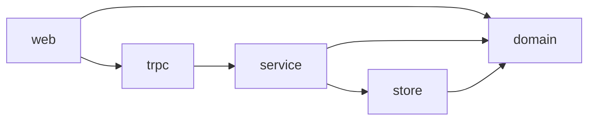

# Wizard-Factory

A pnpm monorepo: a React app talking to a tRPC API, with layer boundaries enforced by lint rules.

## Packages

| Package   | Role                                                        |
| --------- | ----------------------------------------------------------- |
| `domain`  | Zod schemas and their inferred types                        |
| `service` | Functions that validate and act on domain data              |
| `store`   | In-memory state behind functions                            |
| `trpc`    | API router (`appRouter`) and standalone HTTP server         |
| `web`     | Vite + React 19 + TanStack Router/Query + Tailwind frontend |
| `tools`   | Repo maintenance scripts (tsconfig checks)                  |



Dependencies flow one way: `web → trpc → service → store`, and any package may import `domain`. Enforced by dependency-cruiser and the `wizard/*` ESLint rules in `exportRules.ts`.

## Getting started

Requires Node 22 and pnpm 10.

```sh
pnpm install
pnpm --filter @wizard/trpc start   # API on :3000 (API_PORT)
pnpm --filter @wizard/web start    # Web on :8080 (WEB_PORT), proxies /trpc to the API
```

## Checks

```sh
pnpm check      # everything CI runs: tsconfig, types, format, lint, sherif, knip, depcruise, tests
pnpm test:e2e   # Playwright end-to-end tests
```

Husky with lint-staged runs ESLint and Prettier on staged files at commit time.
